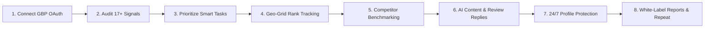

# 📍 Local SEO & Google Business Profile (GBP) Optimization Platform

> **A Production-Grade, AI-Powered Local SEO Autopilot & Geo-Grid Rank Tracking Platform for Agencies, Freelancers, and Multi-Location SMBs.**

---

## 🌟 Executive Summary & Product Vision

This platform is a full-featured, enterprise-ready alternative to **Localo**, **Local Falcon**, **BrightLocal**, and **RightChoice.AI**. It turns Google Business Profile management into an automated, repeatable growth engine:



---

## 📑 Core Features & Modules Overview

### 1. 🔐 Multi-Tenant Authentication & RBAC

> Coarse roles below gate feature access; every enforcement point uses the fine-grained permission strings defined in the Phase 1 Auth & Multi-Tenancy plan (`workspace.view`, `member.invite`, `billing.manage`, etc.). Roles are a UI grouping over that permission layer, not a separate check.

- **Workspace Architecture**: Hierarchical multi-tenancy (`Workspace` ➔ `Team Members` ➔ `Client Locations`).
- **Role-Based Access Control (RBAC)**:
  - `Owner`: Full billing, workspace management, API keys, Google connections.
  - `Admin`: Manage members, profile edits, scans, protection settings.
  - `Member`: Execute smart tasks, reply to reviews, draft posts, run rank scans.
  - `Viewer / Client`: Read-only dashboards and white-labeled report views.
- **Security**: Argon2id password hashing (OWASP baseline params, versioned), Google OAuth 2.0 (`business.manage`), access/refresh JWT pair with rotating 30-day `httpOnly` refresh cookies + token-family replay detection, email verification gating full access, password reset, optional TOTP 2FA (enforceable per-workspace for Owner/Admin), CSRF via double-submit cookie, and per-device session management. Full detail lives in the Phase 1 Auth & Multi-Tenancy plan — this section is the summary, not the spec of record.
- **Cookie & Domain Deployment Topology**:
  - **Single Registrable Domain (Default / Recommended)**: Frontend (e.g. `app.localo.com`) and Backend API (e.g. `api.localo.com`) deployed under the same root registrable domain (`localo.com`). `SameSite=Strict`, `httpOnly`, `Secure` cookies work seamlessly with zero cross-site leak risk.
  - **Cross-Domain / Third-Party Domain Topology**: If Frontend (e.g. `localo.vercel.app`) and Backend API (e.g. `localo-api.fly.dev` or `render.com`) are on different registrable domains, browsers will omit `SameSite=Strict` cookies on cross-origin API requests. For cross-domain topologies:
    1. Set cookie `SameSite=Lax` (or `SameSite=None; Secure`).
    2. Enforce strict double-submit CSRF tokens on all mutating requests (`X-CSRF-Token` header validated against the encrypted cookie).
    3. Configure `TRUST_PROXY_HOPS` in `core-service/.env` according to the reverse proxy depth to maintain reliable IP rate limiting.

### 2. 🌐 Google Business Profile Integration & Real-Time Sync
- **OAuth 2.0 Flow**: Offline access with encrypted refresh token storage (`AES-256-GCM` envelope encryption).
- **Verified 2026 API Mapping**:
  - `Business Information API v1`: Categories, hours, attributes, services, profile updates.
  - `My Business API v4`: Reviews, local posts, photos, and media management.
  - `Performance API v1`: Multi-daily metrics time series (calls, directions, website visits, impressions).
  - `Notifications API v1 & GCP Pub/Sub`: Real-time push webhooks for reviews, external edits, and status changes.
- **Write Safety & Rate Limiter**:
  - Redis token bucket global limiter (project QPM compliance).
  - Per-location edit cooldowns & field change coalescing with unified `updateMask`.
  - Transactional ChangeLog with automated rollback on failed verification.

### 3. 🗺️ Geo-Grid Local Rank Tracking Engine
- **Grid Generator**: Equirectangular coordinate calculations for $N \times N$ presets ($3\times3, 5\times5, 7\times7, 9\times9, 13\times13$) with adaptive spacing (urban $0.8\text{ km}$, suburban $2\text{ km}$, rural $5\text{ km}$).
- **SERP Provider Abstraction**: DataForSEO Google Maps SERP API adapter with fallback adapter (SerpApi) — both providers require live credentials (see Environment Variables).
- **Core Metrics Calculation**:
  - **ARP** (Average Rank Position) over ranked points.
  - **ATRP** (Average Total Rank Position, unranked counted as 21).
  - **SoLV** (Share of Local Voice: $\%$ of grid points ranked in Top 3).
  - **Coverage** ($\%$ of points where business appears in top 20).
  - **Visibility Index**: Weighted position score ($\sum w(\text{rank}) / \text{total}$).
- **Interactive Visualizer**: Mapbox GL JS / Leaflet interactive heatmap with color bands (Green: 1–3, Amber: 4–10, Red: 11–20, Grey: Not Ranked), point-level top 20 drawer, timeline slider, and side-by-side snapshot comparison.

### 4. 🔍 17-Point Automated Local SEO Audit Engine
Computes a normalized **0–100 Profile Health Score** evaluated on connect and weekly:

| Check ID | Group | Check Description | Weight |
| :--- | :--- | :--- | :---: |
| **CAT-01** | Categories | Primary category configured | 8 |
| **CAT-02** | Categories | Primary matches modal category of Top-5 competitors | 6 |
| **CAT-03** | Categories | 3 to 9 relevant secondary categories selected | 4 |
| **CAT-04** | Categories | Secondary categories overlap with market leaders ($\ge 50\%$) | 2 |
| **INF-01** | Info | Business name matches real-world branding (anti-stuffing check) | 4 |
| **INF-02** | Info | Complete NAP (Name, Phone, Address, Website) present | 4 |
| **INF-03** | Info | Regular and upcoming holiday hours configured | 3 |
| **INF-04** | Info | Opening date present | 1 |
| **INF-05** | Info | Service area / storefront address configuration valid | 2 |
| **DES-01** | Description | Length within optimal range (250–750 chars) | 5 |
| **DES-02** | Description | Natural inclusion of primary keyword and city | 4 |
| **DES-03** | Description | Clean description (no phone, URLs, or promotional spam) | 2 |
| **SVC-01/02**| Services | $\ge 5$ services listed with descriptive benefits ($\ge 80\%$) | 9 |
| **ATT-01** | Attributes | $\ge 80\%$ applicable profile attributes answered | 3 |
| **PHO-01..04**| Photos | Logo + Cover set, total photos $\ge$ competitor median, uploaded $<30\text{d}$ | 15 |
| **PST-01/02**| Posts | $\ge 1$ post in last 14 days, $\ge 4$ posts in last 60 days | 8 |
| **REV-01..04**| Reviews | Rating $\ge 4.2$, velocity $\ge$ competitor median, reply rate $\ge 90\%$ ($<72\text{h}$) | 19 |
| **WEB-01..04**| Website | Reachable HTTPS, matching NAP, `LocalBusiness` JSON-LD schema, map embed | 10 |

### 5. ⚡ Smart Task Prioritization Engine
- **Algorithmic Prioritization**:
  $$\text{Priority Score} = \frac{\text{Impact (1--5)} \times \text{Confidence (0--1)}}{\text{Effort (minutes bucket)}} \times \text{Urgency Multipliers}$$
- **Weekly Task Plan**: 5–10 high-leverage tasks generated every Monday at 06:00 local time.
- **Inline Fix Execution**: One-click apply directly to GBP via API or copy-paste assistance.
- **Auto-Verification**: Background verification workers automatically re-sync and verify completed tasks.

### 6. 👥 Competitor Intelligence & Gap Analysis
- **Auto-Detection**: Ranks and tracks rivals appearing most frequently across geo-grid scan points.
- **Side-by-Side Benchmark Matrix**: Live gap analysis on review velocity, average rating, photo count, category combinations, and post recency.
- **Competitor Change Alerts**: Monitors competitor category switches, review spikes, and profile modifications.

### 7. 🤖 AI SEO Assistant & Content Generation
- **Strict Grounding & Guardrails**: ContextBuilder feeds verified profile facts only — zero hallucinated prices, phone numbers, or fabricated claims.
- **Generative Capabilities**:
  - **Review Replies**: Sentiment analysis with tone matching (Empathetic, Professional, Warm), multi-lingual support, and policy check.
  - **Google Posts**: Hook in first 150 chars, seasonal relevance, CTA button generator, image prompt suggestions.
  - **Business & Service Descriptions**: Keyword-natural copy fitting Google's 750-character limit.
  - **Cold Outreach Pitch**: Agency prospect pitch referencing exact audit deficiencies.
- **Security & Integrity**: Prompt injection sanitization, blocklist filtering, fact verification gate, duplicate-content detector.

### 8. 🛡️ 24/7 Profile Protection Engine
- **Baseline Locking**: Stores immutable snapshots of core NAP, hours, categories, and attributes.
- **Unauthorized Edit Detection**: Polls Google changes and intercepts Google-suggested or third-party edits.
- **Auto-Revert & Alerting**: Configurable modes (`Auto-Revert`, `Approve First`, `Alert Only`) with smart debouncing (max 3 auto-reverts/24h before manual escalation).

### 9. ⭐ Review Management & Growth Campaigns
- **Unified Review Inbox**: Multi-location filtering by star rating, sentiment, reply status, and SLA badges ($>48\text{h}$ unreplied).
- **Review Generation Tools**: Direct Google Review Shortlink generator, QR code generator (PNG/SVG), and printable table tent poster templates.
- **Multi-Channel Campaigns**: CSV customer import for SMS, Email, and WhatsApp review requests (Google policy compliant: no review gating or incentives).
- **Deleted Review Tracker**: Flags disappeared reviews to monitor algorithmic purges.

### 10. 📊 White-Label Reporting & Public Growth Tools
- **Client-Ready Reports**: Monthly scheduled or on-demand branded PDFs generated via headless Playwright, complete with before/after heatmap deltas, traffic graphs, and AI executive summaries.
- **Public Lead Magnet Tools**:
  - Free Public Rank Checker ($3\times3$ grid, rate-limited with CAPTCHA).
  - Free `LocalBusiness` Schema Generator & Validator.
  - Free Local SEO Audit Widget for agency lead generation.

---

## 🏗️ System Architecture & Service Topology

The system is architected as a **React.js Frontend + 2 Backend Microservices (Core + AI) + API Gateway**, backed by shared MongoDB Atlas and Redis infrastructure.

```
                         ┌─────────────────────────────────┐
                         │   React.js 18+ · TypeScript     │
                         │ Vite · Tailwind CSS · Mapbox GL │
                         │   Redux Toolkit / RTK Query     │
                         └────────────────┬────────────────┘
                                          │
                                    REST / HTTPS / SSE
                                          │
                         ┌────────────────▼────────────────┐
                         │       API Gateway (Express)     │
                         │  Auth Proxy · Rate Limiting     │
                         │  CSRF · CAPTCHA · Lockout       │
                         └────────┬───────────────┬────────┘
                                  │               │
                     ┌────────────┘               └─────────────┐
                     │ Internal REST                            │ Internal REST
         ┌───────────▼────────────┐                  ┌──────────▼───────────┐
         │      CORE SERVICE      │                  │      AI SERVICE      │
         │ (local-seo-core-service)                  │ (local-seo-ai-service│
         ├────────────────────────┤                  ├──────────────────────┤
         │ • Auth, RBAC & Sessions│                  │ • Manager Agent      │
         │ • Workspaces & Clients │                  │ • SEO Agent          │
         │ • Locations & GBP Sync │                  │ • Content Agent      │
         │ • Audit Engine (17 chk)│◄────────────────►│ • Review Agent       │
         │ • Geo-Grid & Rankings  │   Internal APIs  │ • Report Agent       │
         │ • Competitor Tracking  │ (/internal/...)  │ • ContextBuilder/RAG │
         │ • Smart Tasks Engine   │                  │ • Guardrails & Evals │
         │ • Profile Protection   │                  │ • LLM Providers      │
         │ • Reports & Billing    │                  └──────────────────────┘
         └───────────┬────────────┘
                     │
         ┌───────────┴────────────┐
         ▼                        ▼
┌──────────────────┐    ┌──────────────────┐
│  MongoDB Atlas   │    │  Redis Cluster   │
│ (localseo_core)  │    │  (BullMQ, Cache, │
└──────────────────┘    │   Rate Limiter)  │
                        └─────────┬────────┘
                                  │
                         ┌────────▼────────┐
                         │   Worker Jobs   │
                         │ (incl. email-   │
                         │  queue / Resend)│
                         └────────┬────────┘
                                  │
              ┌───────────────────┼───────────────────┐
              ▼                   ▼                   ▼
     ┌─────────────────┐ ┌─────────────────┐ ┌─────────────────┐
     │   Google GBP    │ │   DataForSEO    │ │ Stripe/Razorpay │
     │  Federated APIs │ │ (SERP Geo-Grid) │ │  (Subscriptions)│
     └─────────────────┘ └─────────────────┘ └─────────────────┘
```

### Architectural Principles & Service Boundaries

1. **Frontend Isolation**: Built with React.js + TypeScript + Vite + Tailwind CSS + Mapbox GL JS + RTK Query. The frontend **never** calls Google Business Profile APIs or LLM APIs directly — all requests pass through the API Gateway.
2. **Core Service**: Owns all business state, persistence, and deterministic operations — multi-tenancy, workspace management, the full auth lifecycle (registration, verification, login, refresh/replay detection, password reset, MFA, sessions, CSRF enforcement upstream at the gateway), location onboarding, Google OAuth token encryption, real-time GBP sync, the 17-point audit engine, geo-grid scan pipelines, smart task state machines, profile protection, billing, and reporting.
3. **AI Service**: An AI/agent orchestration service that does **not** own primary business data. Fetches clean, verified context from Core via internal APIs and returns structured, guardrailed outputs.
4. **Crucial Safety Rule — AI Never Modifies GBP Directly**:
   ```
   AI Agent ➔ Generates Structured Action Draft ➔ Core Service Validation ➔ Human Review/Approval ➔ Google GBP API Execution ➔ Verification Loop
   ```
5. **Shared Database & Redis Infrastructure**: MongoDB Atlas holds both Core collections and AI metadata collections; Redis backs BullMQ workers (scan fan-out, weekly audit crons, review syncs, transactional email queue), rate limiters, token bucket quotas, and distributed locks.

---

## 📁 Repository Layout

```
LocalSEO/
├── frontend/
│   └── web/                            # React.js SPA (TypeScript + Vite)
│       ├── src/
│       │   ├── app/                    # React Router configuration & entry
│       │   ├── components/             # Reusable UI primitives, Modals, Drawers
│       │   ├── features/
│       │   │   ├── auth/               # Login, Signup, Verify, Reset, MFA, Sessions, Workspace switcher
│       │   │   ├── locations/          # Location overview, settings, GBP connect
│       │   │   ├── rank-tracking/      # Mapbox GL Geo-Grid Heatmap, timeline slider
│       │   │   ├── audit/              # 17-point audit checks & health ring
│       │   │   ├── smart-tasks/        # Weekly prioritized task cards & inline actions
│       │   │   ├── competitors/        # Competitor matrix & gap highlights
│       │   │   ├── reviews/            # Unified review inbox & AI reply drawer
│       │   │   ├── posts/              # Post composer, calendar & AI ideas
│       │   │   ├── protection/         # Field lock toggles & change timeline
│       │   │   └── reports/            # Branded PDF previews & download
│       │   ├── store/                  # Redux Toolkit & RTK Query API slices
│       │   └── hooks/                  # Custom hooks (useGeoGrid, useScanStream, useAuth)
│       ├── package.json
│       └── vite.config.ts
│
├── backend/
│   ├── api-gateway/
│   │   ├── src/
│   │   │   ├── middleware/             # AuthJWT, CSRF, CAPTCHA, Lockout, RateLimiter, RequestLogger, Cors
│   │   │   ├── routes/                 # Gateway routes + /v1/webhooks/resend passthrough
│   │   │   ├── swagger/                # Unified Swagger UI & OpenAPI 3.0 specs
│   │   │   └── server.ts
│   │   └── package.json
│   │
│   ├── core-service/                   # local-seo-core-service
│   │   ├── src/
│   │   │   ├── modules/
│   │   │   │   ├── auth/               # Registration, verification, login, refresh, reset, MFA, sessions
│   │   │   │   ├── workspaces/         # Workspaces, memberships, invites, soft-delete + reaper
│   │   │   │   ├── locations/          # GBP location onboarding & metadata
│   │   │   │   ├── google/             # OAuth 2.0 flow, token encryption, Pub/Sub webhook
│   │   │   │   ├── audits/             # 17-point audit engine, score calculator
│   │   │   │   ├── rankings/           # Grid coordinate generator, SERP orchestrator
│   │   │   │   ├── competitors/        # Rival auto-detection & gap analysis
│   │   │   │   ├── reviews/            # Review sync, sentiment, SLA tracker
│   │   │   │   ├── tasks/              # Smart task priority engine, auto-verify loop
│   │   │   │   ├── posts/              # Google post scheduler & media manager
│   │   │   │   ├── protection/         # Baseline snapshots, diffing & auto-revert
│   │   │   │   ├── reports/            # PDF report generator (Playwright worker)
│   │   │   │   └── billing/            # Stripe & Razorpay webhook handlers, credit ledgers
│   │   │   ├── internal/               # Protected APIs consumed exclusively by AI service
│   │   │   ├── jobs/                   # BullMQ worker consumers (scans, crons, email.worker.ts, reaper)
│   │   │   ├── providers/              # SERP (DataForSEO/SerpApi), Resend email, SMS/WhatsApp, Storage
│   │   │   ├── templates/emails/       # Verification, reset, invite, security-alert templates
│   │   │   ├── models/                 # Mongoose schemas & indexes
│   │   │   └── server.ts
│   │   └── package.json
│   │
│   └── ai-service/                     # local-seo-ai-service
│       ├── src/
│       │   ├── agents/                 # ManagerAgent, SEOAgent, ContentAgent, ReviewAgent, ReportAgent
│       │   ├── tools/                  # getLocation, getAudit, getRankings, getCompetitors, getReviews, etc.
│       │   ├── context/                # ContextBuilder, LocationContext, SEOContext
│       │   ├── prompts/                # Versioned prompt templates (seo/reviews/posts/reports)
│       │   ├── guardrails/             # FactValidator, PromptSanitizer, OutputValidator, ActionGuard
│       │   ├── providers/              # OpenAIProvider, GeminiProvider, AnthropicProvider (tertiary failover)
│       │   ├── memory/                 # AgentMemory (brand voice, past generations)
│       │   ├── evaluations/            # Golden evaluation test suites
│       │   └── server.ts
│       └── package.json
│
├── packages/
│   ├── shared/                         # Zod schemas, constants, API response helpers
│   ├── types/                          # Shared TypeScript interfaces for entities & DTOs
│   ├── config/                         # Shared ESLint, Prettier, TypeScript configs
│   └── google-client/                  # Strongly-typed Google Business Profile API client
│       └── src/
│           ├── AccountClient.ts
│           ├── BusinessInformationClient.ts
│           ├── PerformanceClient.ts
│           ├── ReviewClient.ts
│           ├── PostClient.ts
│           ├── MediaClient.ts
│           ├── NotificationClient.ts
│           └── GoogleLimiter.ts
│
├── infrastructure/
│   ├── docker/
│   └── nginx/
│
├── docs/
│   ├── Local-SEO-Platform-SRS.pdf
│   ├── Local-SEO-Platform-Production-Spec.pdf
│   ├── Phase1-Auth-Multi-Tenancy-Plan.md   # spec of record for section 1
│   └── Localo-Teardown.pdf
│
├── .env.example
├── docker-compose.yml
├── package.json
└── README.md
```

---

## 🗄️ MongoDB Data Models (`localseo_core`)

All collections reside within `localseo_core` with strict workspace isolation (`workspaceId` compound index).

### Auth & Tenancy Collections
- **`users`**: Credentials (Argon2id + `argon2Version`), `status` (`PENDING_VERIFICATION`/`ACTIVE`/`SUSPENDED`/`DELETED`), `mfaEnabled`, `emailSuppressed`, preferences.
- **`refreshTokens`**: Token-family rotation lineage, hashes, revocation state — see auth plan for field list.
- **`mfaSecrets`**: Encrypted TOTP secret + hashed backup codes, keyed to `userId`.
- **`workspaces`**: Tenancy configs, `status` (`ACTIVE`/`PENDING_DELETION`/`DELETED`), `deletionScheduledAt`, subscription tier, white-label branding, resource limits.
- **`workspaceMembers`**: User-to-workspace mappings with scoped roles and permission overrides.
- **`workspaceInvites`**: Pending/accepted/expired/revoked invitations with hashed single-use tokens.
- **`auditLogs`**: Immutable append-only security & business-action trail (`actorUserId`, `action`, `resourceType`, `before`/`after`, `correlationId`) — actor fields are anonymized, never row-deleted, on user/workspace erasure.

### Core Business Collections
- **`locations`**: Google Business Profiles (placeId, address, geo coordinates, categories, hours, status, protection mode).
- **`googleAccounts` / `googleTokens`**: OAuth connection state, encrypted refresh tokens (`AES-256-GCM`).
- **`audits` & `auditSignals`**: 17-point audit runs, score breakdown, signal-by-signal evaluations, competitor benchmarks.
- **`geoScans` & `geoGridPoints`**: Geo-grid scan runs, lat/lng matrix points, top-20 rank lists (time-series).
- **`rankings`**: Historical keyword ranking timelines, ARP, ATRP, SoLV metrics.
- **`competitors`**: Competitor profiles detected across grid scans, review velocity, gap scores.
- **`reviews`**: Synced customer reviews, star ratings, sentiment analysis, reply status, SLA tracking.
- **`posts`**: Scheduled and published Google updates, offers, events, media attachments.
- **`smartTasks`**: Weekly prioritized actionable fixes (`todo`, `in_progress`, `done`, `snoozed`, `verified`).
- **`reports`**: Monthly scheduled/on-demand white-label reports, PDF storage links, public share tokens.
- **`subscriptions` & `usage`**: Stripe/Razorpay customer IDs, plan limits, credit ledgers.
- **`processedWebhooks`**: Idempotency ledger for Stripe/Razorpay/Resend webhook events.
- **`snapshots` & `changeLogs`**: Profile snapshots for 24/7 protection, external change detection, audit trails.
- **`notifications`**: User alert feeds (new reviews, unauthorized edits, rank changes, task roll-overs).

### AI & Agent Collections
- **`aiRuns`**: Traceable log of every agent execution — prompt version, input context, structured output, latency.
- **`aiUsage`**: Token accounting and credit debits per workspace.
- **`aiApprovals`**: Human-in-the-loop approval queue for AI-generated posts, review replies, and profile edits.
- **`aiConversations`**: Agent conversational thread memory.
- **`aiEvaluations`**: Automated regression test results against golden datasets.

```typescript
// Key Model Interfaces
interface IWorkspace {
  _id: ObjectId;
  name: string;
  status: 'ACTIVE' | 'PENDING_DELETION' | 'DELETED';
  deletionScheduledAt?: Date;
  plan: { key: 'free' | 'starter' | 'pro' | 'agency'; status: string; periodEnd: Date };
  branding: { logoUrl?: string; primaryColor?: string; domain?: string; agencyName?: string };
  limits: { locations: number; seats: number; scanCredits: number; aiCredits: number };
  billing: { provider: 'stripe' | 'razorpay'; customerId: string; subId?: string };
  ownerId: ObjectId;
}

interface ILocation {
  _id: ObjectId;
  workspaceId: ObjectId;
  connectionId?: ObjectId;
  mode: 'connected' | 'view_only';
  placeId: string;
  name: string;
  address: { addressLines: string[]; locality: string; administrativeArea: string; postalCode: string; country: string };
  geo: { type: 'Point'; coordinates: [number, number] }; // [lng, lat]
  phone?: string;
  website?: string;
  primaryCategory: { id: string; name: string };
  categories: Array<{ id: string; name: string }>;
  status: 'ok' | 'suspended' | 'inaccessible' | 'disconnected';
  protection: { enabled: boolean; mode: 'revert' | 'approve' | 'alert'; fields: string[] };
  brandVoice: { tone: string; dos: string[]; donts: string[]; signOff?: string };
}

interface IScanRun {
  _id: ObjectId;
  workspaceId: ObjectId;
  locationId: ObjectId;
  keywordId: ObjectId;
  grid: { n: number; spacingKm: number; center: [number, number] };
  status: 'CREATED' | 'QUOTED' | 'QUEUED' | 'RUNNING' | 'COMPLETED' | 'PARTIAL' | 'FAILED';
  credits: { reserved: number; charged: number; refunded: number };
  metrics: { arp: number; atrp: number; solv: number; coverage: number; visibility: number };
  startedAt?: Date;
  finishedAt?: Date;
}
```

---

## ⚙️ Environment Variables (`.env.example`)

```bash
# General
NODE_ENV=development
PORT=5000
APP_URL=http://localhost:3000

# Databases
MONGO_URI=mongodb://localhost:27017/localo_db
REDIS_URL=redis://localhost:6379

# Auth — Tokens & Session Security
JWT_ACCESS_SECRET=super_secret_access_jwt_key_here
JWT_REFRESH_SECRET=super_secret_refresh_jwt_key_here
ENC_KEY_ID=aes_256_kms_key_id                 # envelope-encrypts Google refresh tokens AND MFA TOTP secrets
CSRF_COOKIE_NAME=csrfToken

# Bot & Abuse Protection
CAPTCHA_PROVIDER=turnstile                    # turnstile | hcaptcha
CAPTCHA_SITE_KEY=your-captcha-site-key
CAPTCHA_SECRET_KEY=your-captcha-secret-key

# Transactional Email (Resend)
RESEND_API_KEY=your-resend-api-key
RESEND_WEBHOOK_SECRET=whsec_resend_svix_secret
EMAIL_FROM=notifications@yourdomain.com

# Google Cloud Platform (GBP Integration)
GOOGLE_CLIENT_ID=your-gcp-client-id.apps.googleusercontent.com
GOOGLE_CLIENT_SECRET=your-gcp-client-secret
GOOGLE_REDIRECT_URI=http://localhost:5000/v1/google/callback
GCP_PROJECT_ID=your-gcp-project-id
PUBSUB_TOPIC=gbp-notifications
PUBSUB_AUDIENCE=https://api.yourdomain.com/webhooks/gbp/pubsub
PLACES_API_KEY=your-google-places-new-api-key

# SERP & Geo-Grid Providers
SERP_PROVIDER=dataforseo                      # dataforseo | serpapi | mock
DATAFORSEO_LOGIN=your-dataforseo-login
DATAFORSEO_PASSWORD=your-dataforseo-password
SERPAPI_API_KEY=your-serpapi-key              # canonical SerpApi credential (SERPAPI_KEY also accepted)
SERP_DAILY_BUDGET_USD=50.00

# LLM Providers
LLM_PROVIDER=openai                           # openai | gemini | anthropic
LLM_API_KEY=your-openai-api-key
LLM_FAILOVER_PROVIDER=gemini
LLM_FAILOVER_API_KEY=your-gemini-api-key
LLM_TERTIARY_PROVIDER=anthropic
LLM_TERTIARY_API_KEY=your-anthropic-api-key
LLM_MODEL_FAST=gpt-4o-mini
LLM_MODEL_STRONG=gpt-4o

# Payments
STRIPE_SECRET_KEY=sk_test_...
STRIPE_WEBHOOK_SECRET=whsec_...
RAZORPAY_KEY_ID=rzp_test_...
RAZORPAY_KEY_SECRET=your-razorpay-secret
RAZORPAY_WEBHOOK_SECRET=your-razorpay-webhook-secret

# Storage
S3_BUCKET=localo-media-assets
S3_REGION=us-east-1
AWS_ACCESS_KEY_ID=your-aws-access-key
AWS_SECRET_ACCESS_KEY=your-aws-secret-key

# Maps
MAPBOX_TOKEN=pk.your_mapbox_public_token

# Observability
SENTRY_DSN=your-sentry-dsn
LOG_LEVEL=info
```

---

## 🚀 12-Week Production Delivery Roadmap

```
Week 1-2 │ Foundation: Turborepo, Mongo/Redis schemas, GCP Project setup,
         │ full hardened Auth (register/verify/login/refresh/reset/MFA/
         │ sessions/CSRF/Resend queue) per the Phase 1 Auth plan
Week  3  │ GBP OAuth Connection, Location Import & AES-256 Encrypted Token Vault
Week  4  │ Real-Time Sync Engine: Reviews, Info, Posts, Media, Rate Limiters & Pub/Sub
Week  5  │ 17-Point Audit Engine & Interactive Health Score UI
Week  6  │ Geo-Grid Generator, SERP Adapter (DataForSEO + SerpApi fallback), Scan Pipeline & Credits Ledger
Week  7  │ Interactive Heatmap (Mapbox GL), Historical Replay & Competitor Auto-Detection
Week  8  │ AI System: Prompt Registry, Brand Voice, Review Replies, Google Posts & Policy Gates
Week  9  │ Smart Task Engine, Priority Formulas & Auto-Verification
Week 10  │ Unified Review Inbox, SLA Badges, Post Calendar & Media Management
Week 11  │ White-Label PDF Reports (Playwright), Share Links & Multi-Tier Billing
Week 12  │ 24/7 Profile Protection Engine, Hardening, Chaos & Load Testing, Beta Onboarding
```

> Auth absorbing two full weeks (vs. one in earlier drafts) reflects the actual scope of the finalized Phase 1 plan — compressing it back to one week means shipping without verification, MFA, or session management, which defeats the "production-grade" goal stated up front.

## 🛡️ Production-Grade Edge Cases & Resilience Matrix

Building a true SaaS platform that operates on live Google Business Profiles and handles real financial transactions requires defense-in-depth across the following **22** categories:

### 1. 🔐 Multi-Tenant Isolation & Zero Leakage
* **Cross-Tenant IDOR Prevention**: Every database query across all collections is strictly scoped by `workspaceId` at both the repository and service layers (`Location.findOne({ _id, workspaceId })`). Never use raw `findById(id)`.
* **Zero-Knowledge 404s**: Requests for non-existent IDs and IDs belonging to other workspaces return an identical generic `404 Not Found` response with no hint of entity existence, preventing cross-tenant enumeration attacks.
* **Storage Path Isolation**: All S3/Cloudinary object paths are strictly namespaced: `/{workspaceId}/{locationId}/...` and served exclusively via short-lived signed URLs.

### 2. 👥 RBAC Privilege Escalation & Session Invalidation
* **Role Downgrades & Evictions**: If an Admin is demoted to Viewer or removed from a workspace while holding an active session, their JWT claims are immediately invalidated via a Redis session version epoch check (`user:session_version:{userId}`).
* **Last-Owner Protection**: Workspaces enforce a strict constraint preventing the sole Owner from deleting their account or demoting themselves without transferring workspace ownership.
* **Invitation Verification**: Invitations verify the authenticated user's email matches the invite recipient, auto-expire after 7 days, and invalidate upon revocation.

### 3. 🔑 Authentication, Session & Token Security
* **Refresh-Token Family Rotation & Replay Detection**: Refresh tokens are single-use. If a previously exchanged token ($T_A$) is presented again after rotation ($T_B$), the entire token family is flagged as compromised and all sessions for that user are terminated immediately.
* **Global Session Revocation**: Password changes, 2FA alterations, or account deletion events immediately invalidate all active access and refresh tokens across all devices.
* **CSRF & Brute Force Defense**: All cookie-authenticated state-changing requests require a cryptographically secure double-submit CSRF token. Login endpoints employ progressive IP/account lockouts and CAPTCHA against credential stuffing.

### 4. 🧨 Universal Idempotency Engine
* **Idempotency-Key Header**: Every state-mutating or money-impacting endpoint (`/subscriptions`, `/credits/purchase`, `/scans`, `/google/posts`, `/reviews/:id/reply`, `/locations/:id/sync`) mandates an `Idempotency-Key` header stored in Redis with a 24-hour TTL.
* **In-Flight Locking**: Simultaneous duplicate requests wait for the active operation to complete and receive the exact cached response, preventing double-billing on network timeouts or rapid user clicks.

### 5. 💳 Billing, Webhooks & Atomic Credit Deductions
* **Atomic Credit Balances**: Credit consumption operations use atomic conditional database updates (`$inc: { balance: -cost }` with query `balance >= cost`), eliminating negative balance race conditions under concurrent requests.
* **Webhook Idempotency & Out-of-Order Delivery**: Stripe, Razorpay, and Resend webhook events are tracked in the `processedWebhooks` ledger. Events arriving out of order verify timestamp sequences before altering state.
* **Dunning & Grace Periods**: Failed subscription renewals trigger a 7-day grace period with in-app alerts; accounts downgrade to Free tier (read-only for surplus locations) without deleting ranking history.

### 6. ⚙️ BullMQ & Background Worker Resilience
* **Crash Recovery Mid-Scan**: If a worker pod restarts halfway through a 49-point geo-grid scan, the scan state machine preserves completed points, reschedules the remainder, and prevents duplicate SERP calls or billing.
* **Poison Pill & Stalled Job Isolation**: Failed jobs retry with exponential backoff (3–5 attempts). Repeated unhandled exceptions transfer to a Dead-Letter Queue with an admin alert and replay UI.
* **Graceful Shutdown**: On `SIGTERM`, workers stop pulling new tasks and allow up to 30 seconds for in-flight Google writes and SERP requests to finish.

### 7. 🌐 External Provider Failure & Circuit Breakers
* **Circuit Breakers for External APIs**: Google GBP, DataForSEO/SerpApi, OpenAI/Gemini/Anthropic, Stripe/Razorpay, Resend, and Mapbox are guarded by three-state circuit breakers (`CLOSED` ➔ `OPEN` ➔ `HALF-OPEN`). Failure rate above 20% over 60 seconds short-circuits immediately.
* **LLM Provider Failover**: Primary (OpenAI) → secondary (Gemini) → tertiary (Anthropic). If all three are unreachable, endpoints return `{ status: "AI_UNAVAILABLE", retryable: true }` without fabricating data.

### 8. 🤖 AI Agent Execution & Tool Allowlists
* **Step Count Ceiling**: Agents enforce `maxSteps: 8` and `maxToolCalls: 10` per run.
* **Strict Per-Agent Tool Allowlists**: `ReviewAgent` has `getReview`/`draftReply` only — never `deleteWorkspace`, `changeBilling`, or `updateLocationNAP`.
* **Execution Timeouts**: `AbortController` timeouts (20s fast tasks, 60s complex reports).

### 9. 🧠 AI Context Freshness & Grounding
* **Verified Fact Grounding**: `ContextBuilder` attaches freshness metadata (`{ source: "gbp", retrievedAt, maxAge: 300 }`).
* **Pre-Publish Re-verification**: Sensitive fields (phone, address, hours) require fresh Core Service verification before any AI-generated draft is published.

### 10. 📝 Event Source Distinction (Protection Engine)
* **Granular Change Classification**: `INTERNAL_PLATFORM` (auto-accepted), `GOOGLE_UPDATE` (queued for review), `BUSINESS_OWNER`, `EXTERNAL_API`, `UNKNOWN` (alerted/reverted per mode).
* **Anti-Loop Debounce**: Max 3 reversions per field per 24h; a 4th consecutive external edit pauses auto-revert and escalates to the owner.

### 11. 🔄 Sync Consistency & Distributed Locks
* **Single-Flight Sync**: Redis lock (`sync:location:{locationId}`) prevents manual sync, cron sync, and Pub/Sub events from running concurrently on the same location.
* **Out-of-Order Sync Rejection**: Updates carry monotonic `syncVersion`/`sourceTimestamp`; stale responses are discarded.

### 12. 📡 Pub/Sub Webhook Security
* **OIDC Signature Verification**: Incoming Pub/Sub push webhooks verify the Google-signed OIDC JWT, validating audience and service-account allowlists.
* **At-Least-Once Delivery Handling**: Messages deduplicated on `messageId` via Redis `SETNX` (24h TTL), acknowledged only after safe queue dispatch.

### 13. 🌎 Geo-Grid Boundaries & Localization
* **Geographic Coordinate Validation**: Center/grid points validated within valid limits ($-90 \le \text{lat} \le 90$, $-180 \le \text{lng} \le 180$), handling International Date Line cases.
* **Scan Localization Parameters**: Scans persist `hl`/`gl` and device type to prevent ambiguous SERP returns across borders.

### 14. 🔎 SERP Provider Schema Normalization
* **Provider-Agnostic Raw Storage**: Raw SERP responses stored immutably with `provider`, `providerRequestId`, `parserVersion`. A unified normalization layer computes metrics so switching providers never corrupts historical timelines.

### 15. 📊 Audit Engine Versioning
* **Immutable Rulesets**: Audit scores store `{ auditVersion, rulesVersion, score }`. Improving the algorithm never retroactively reinterprets past scores without explicit user-initiated recalculation.

### 16. 📈 Ranking History Correction Flags
* **Observation State Tracking**: Records tag `OBSERVED`, `CORRECTED`, `ESTIMATED`, or `MISSING` for full transparency in historical graphs.

### 17. 🗑️ Data Lifecycle, Disconnect & GDPR/DPDP Compliance
* **Clean Disconnect State**: Disconnecting Google purges encrypted refresh tokens, halts sync crons, and suspends scheduled posts immediately.
* **Data Erasure Workflows**: Workspace deletion follows the soft-delete + 30-day reaper flow (see auth plan), with `auditLogs` actor fields anonymized rather than deleted, satisfying GDPR/India DPDP Act 2023 erasure without breaking audit integrity.

### 18. 🔒 Secrets Envelope Encryption & Key Versioning
* **KMS Envelope Encryption**: Google OAuth refresh tokens and MFA TOTP secrets are encrypted using `AES-256-GCM` with versioned data encryption keys.
* **Zero Secrets in Logs**: Pino formatters redact `Authorization`, `Cookie`, tokens, and sensitive PII from all logs and traces.

### 19. 🌐 Website Crawler & SSRF Re-Validation
* **SSRF Re-validation on Redirects**: The audit crawler re-evaluates destination IPs after every redirect, blocking pivots to internal addresses.
* **Crawler Guardrails**: 5-second timeout, 1 MB content cap, gzip bomb detection, respectful user-agent headers.

### 20. 📁 White-Label Reports & Playwright Workers
* **Asynchronous PDF Generation**: Runs in a dedicated worker queue; handles missing logos/oversized assets; documents stored on S3 with presigned, expiring share URLs.

### 21. 🔔 Notification Idempotency & Quiet Hours
* **Notification Key Deduplication**: Dedup keys (`eventId + type + recipient`) prevent duplicate emails/push during rapid sync loops.
* **Timezone Awareness**: Delivery respects workspace IANA timezones and quiet hours for non-critical notifications.

### 22. 🩺 Observability & Distributed Tracing
* **End-to-End Correlation IDs**: Every request gets an `X-Correlation-ID` propagated across Gateway ➔ Core Service ➔ AI Service ➔ BullMQ Workers ➔ external calls, captured in structured JSON logs and Sentry.

---

## 📖 Interactive API Documentation & Swagger UI

* **Unified Gateway Documentation**: Mounted at `http://localhost:5000/api-docs`.
* **Automated Contract Generation**: Schemas kept in sync via `@asteasolutions/zod-to-openapi` from `packages/shared`.
* **Interactive Testing & Auth**: Bearer token auth via Swagger's Authorize button; `X-Workspace-Id` and `Idempotency-Key` headers; preloaded request bodies and curl commands.

### Categorized Swagger Endpoint Tags
1. `🔐 Auth & Tenancy`: `/v1/auth/register`, `/v1/auth/login`, `/v1/auth/refresh`, `/v1/auth/verify-email`, `/v1/auth/forgot-password`, `/v1/auth/reset-password`, `/v1/auth/mfa/*`, `/v1/auth/sessions`, `/v1/workspaces`.
2. `🌐 Google Business Profile`: `/v1/google/connect`, `/v1/google/callback`, `/v1/locations/import`, `/v1/locations/:id/sync`.
3. `🔍 17-Point Audit`: `/v1/locations/:id/audit`, `/v1/locations/:id/audit/run`.
4. `🗺️ Geo-Grid Rank Tracking`: `/v1/locations/:id/scans`, `/v1/scans/:id`, `/v1/scans/:id/events` (SSE).
5. `👥 Competitor Intelligence`: `/v1/locations/:id/competitors`, `/v1/locations/:id/competitors/benchmark`.
6. `⚡ Smart Tasks`: `/v1/locations/:id/tasks`, `/v1/tasks/:id/apply`, `/v1/tasks/:id/snooze`.
7. `🤖 AI Assistant & Agents`: `/v1/ai/review-reply`, `/v1/ai/post`, `/v1/ai/description`, `/v1/ai/chat`.
8. `⭐ Reviews & Reputation`: `/v1/locations/:id/reviews`, `/v1/reviews/:id/reply`, `/v1/reviews/campaigns`.
9. `🛡️ 24/7 Profile Protection`: `/v1/locations/:id/protection`, `/v1/protection/events/:id/revert`.
10. `📊 White-Label Reports`: `/v1/reports`, `/v1/reports/:id/pdf`, `/v1/reports/share/:token`.
11. `💳 Billing & Credits`: `/v1/billing/checkout`, `/v1/billing/portal`, `/v1/billing/credits`.
12. `🔔 Webhooks`: `/v1/webhooks/resend`, `/v1/webhooks/stripe`, `/v1/webhooks/razorpay`, `/v1/webhooks/gbp/pubsub`.

---

## 🧪 Core Acceptance Criteria & Quality Gates

| ID | Criteria | Verified Condition |
| :--- | :--- | :--- |
| **AC-0** | Auth Lifecycle | Registration gates full access behind email verification; password reset invalidates all sessions; MFA-enabled login requires a challenge step; CSRF-protected mutations reject mismatched tokens. |
| **AC-1** | Geo-Grid Scan Execution | For a connected profile, a $7\times7$ scan records 49 coordinate points, calculates ARP, ATRP, SoLV, and renders the colored heatmap. |
| **AC-2** | AI Auto-Reply Gate | When auto-reply is enabled for $5\star$ reviews, an AI-generated, policy-checked response is drafted and published within 15 minutes. |
| **AC-3** | 24/7 Profile Protection | An external unauthorized change to the phone/name/address is detected, debounced, reverted, and alerts the owner with a before/after diff. |
| **AC-4** | Task Auto-Verification | When a task is performed (e.g. "Add $\ge 10$ photos"), the background sync verifies the change and auto-marks the task complete. |
| **AC-5** | Credit & Quota Enforcement | If a workspace exhausts its scan/AI credits, third-party SERP/LLM calls are immediately blocked with an upgrade prompt. |
| **AC-6** | White-Label Reporting | Recurring monthly reports with custom agency logo/color palette are generated via Playwright and accessible via hashed public links. |

---

## 🎯 Getting Started & Next Steps

This README includes product vision and planned capabilities. A capability described here is not necessarily implemented or production-ready; use `BUILD_ROADMAP.md` for implementation status and `RANKORA_PRODUCTION_PLAN.md` for the product gap assessment.

### Start the local development stack

Requirements: Docker Desktop with Compose enabled. From the repository root run:

```powershell
docker compose up --build
```

Open the frontend at `http://localhost:5174`. The gateway is available at `http://localhost:5002`; the core API is internal to the Compose network. Redis is at `localhost:6379`, and the Compose MongoDB is at `localhost:27018` (mapped to port `27017` inside the container to avoid conflicts with a local MongoDB). Compose waits for MongoDB and Redis health before starting the API and worker, then waits for API readiness before starting the gateway and frontend.

This Compose stack uses the mock SERP provider and development-only credentials. It is for local development only; do not expose it publicly or use these values in staging or production. Stop the stack with `docker compose down`; MongoDB data remains in the named `mongo_data` volume. To remove local database data too, run `docker compose down -v`.

Alternatively, after starting MongoDB and Redis locally, `npm run dev` launches the four application processes. Copy `Backend/core-service/.env.example` to an appropriate local environment file and set values for your machine first.

---

## 🛠️ Scraper Audits, Fixture Capture & Soak Testing Runbook

The Tier-1 Google Maps HTTP Scraper includes three standalone empirical audit harnesses and a TLS fingerprint inspector:

### 1. Payload Size & Compression Audit
Measures exact Brotli/Gzip wire bytes and uncompressed JSON payloads against live queries or local fixtures:
```bash
# Evaluate against local fixtures (fast / offline)
npm run audit:payload

# Run live audit through paid proxies and capture sanitized fixtures for parser testing
npm run audit:payload -- --live --save-raw test/fixtures/serp/captured
```
*Outputs detailed markdown report to [`docs/payload_size_report.md`](file:///c:/Users/uditp/Desktop/Localo/docs/payload_size_report.md).*

### 2. Live Rank Accuracy & Spatial Snapping Audit
Compares rank positions at exact pin coordinates vs H3-snapped centroid coordinates across metro (Res 9) and non-metro (Res 8) areas:
```bash
# Evaluate accuracy across captured fixtures
npm run audit:accuracy

# Run live side-by-side audit and save raw response bodies with credentials/IPs redacted
npm run audit:accuracy -- --live --samples 10 --save-raw test/fixtures/serp/captured
```
*Outputs detailed markdown report to [`docs/rank_accuracy_audit_report.md`](file:///c:/Users/uditp/Desktop/Localo/docs/rank_accuracy_audit_report.md).*

### 3. Proxy Fleet Soak Test (Resumable & Safe)
Runs continuous load through configured paid proxies (`SCRAPER_PROXY_URL` / `PROXY_SESSION_TEMPLATE`), measuring block rates, latency percentiles, and bandwidth costs:
```bash
# Quick smoke test (5s at 2 RPS)
npm run audit:soak -- --duration-seconds 5 --rps 2 --concurrency 2

# Full soak run with warmup, early block-rate abort, and periodic progress logs
npm run audit:soak -- --duration-seconds 3600 --rps 5 --concurrency 5 --warmup 10 --max-block-rate 15 --report-every 30

# Safe to interrupt at any time with Ctrl+C (SIGINT); flushes and saves report immediately.
```
*Outputs detailed markdown report to [`docs/proxy_soak_test_report.md`](file:///c:/Users/uditp/Desktop/Localo/docs/proxy_soak_test_report.md).*

### 4. TLS Fingerprint & JA3/JA4 Inspector
Evaluates client TLS fingerprints of `UndiciFetcher` and `TlsImpersonatingFetcher` against a reference Chrome Mobile baseline:
```bash
npm run audit:tls
```
*The default fetcher is selectable via `HTTP_FETCHER=undici|tls` (defaults to `undici`).*

---

## 🔍 Google Search Console (GSC) Integration

Google Search Console integration operates independently of Google Business Profile (GBP) without requiring GBP developer API approvals. For full details on endpoints, schemas, mathematical position weighting, and Google test user setup, see [`Backend/core-service/README.md`](file:///c:/Users/uditp/Desktop/Rankora/Backend/core-service/README.md).

### Key Endpoints:
- `GET /v1/workspaces/:id/gsc/sites`: List verified domain and URL-prefix properties.
- `POST /v1/workspaces/:id/gsc/locations/:locId/connect`: Connect property and initiate 16-month historical sync in background.
- `GET /v1/workspaces/:id/gsc/locations/:locId/performance?range=28d|90d`: Daily clicks, impressions, CTR, and weighted position with data notes.
- `GET /v1/workspaces/:id/gsc/locations/:locId/top-queries`: Discovered and striking distance (positions 8-20) query opportunities.
- `GET /v1/workspaces/:id/gsc/locations/:locId/keyword-metrics`: Search Console metrics mapped to active tracked keywords.
- `POST /v1/workspaces/:id/gsc/locations/:locId/sync`: Manual 7-day incremental sync (rate-limited to 15m).
