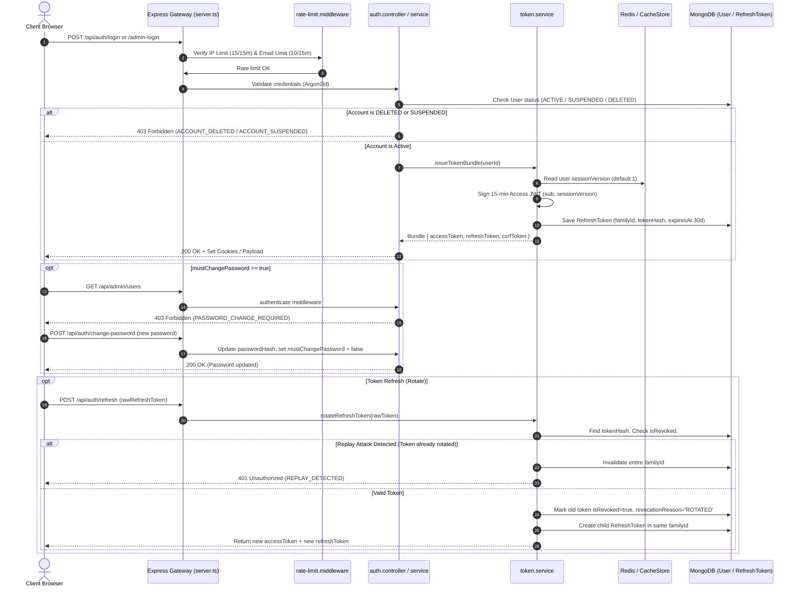
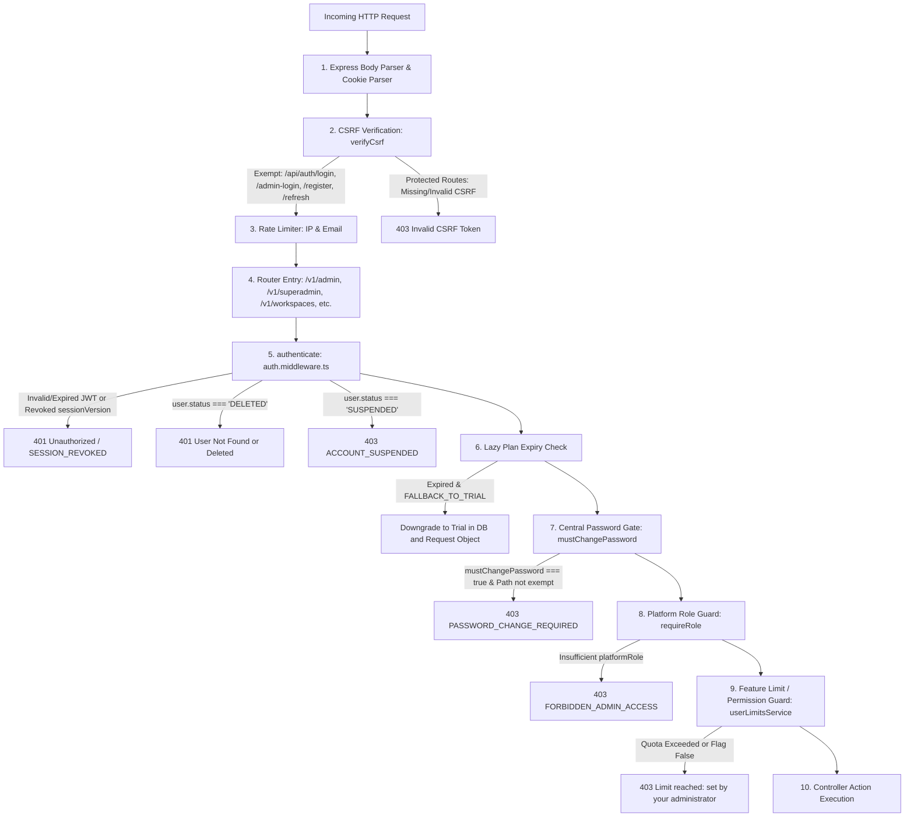

# Rankora Platform Architecture & End-to-End Flow

This document details the architecture, request lifecycles, role permissions, enforcement mechanisms, and administrative operations of the Rankora platform system.

---

## 1. Overview

Rankora implements a **3-role platform system** (`SUPER_ADMIN`, `ADMIN`, `USER`) running on **one backend**, **one frontend**, and a **single unified authentication system**. 

### Platform Roles vs. Workspace Roles
Rankora maintains strict separation between **Platform Roles** (system-wide governance and billing tiers) and **Workspace Roles** (multi-tenant collaborative access):

```
+-----------------------------------------------------------------------------------+
|                                  PLATFORM LEVEL                                   |
|   PlatformRole on User: SUPER_ADMIN  |  ADMIN  |  USER                            |
|   - Determines platform feature access, plans, usage quotas, and administrative powers|
+-----------------------------------------------------------------------------------+
                                         |
                                         v
+-----------------------------------------------------------------------------------+
|                                 WORKSPACE LEVEL                                   |
|   WorkspaceMember Role: owner  |  admin  |  member                                |
|   - Determines permissions within a specific business/location tenant             |
|   - Governed by packages/shared/src/permissions/roles.ts                          |
+-----------------------------------------------------------------------------------+
```

- **Platform Role** (`User.platformRole` in [`Backend/core-service/src/models/User.ts`](file:///c:/Users/uditp/Desktop/Rankora/Backend/core-service/src/models/User.ts#L68)): Controls platform access, billing plan, resource limits, and administrative consoles.
- **Workspace Role** (`WorkspaceMember.role` in [`Backend/core-service/src/models/WorkspaceMember.ts`](file:///c:/Users/uditp/Desktop/Rankora/Backend/core-service/src/models/WorkspaceMember.ts)): Controls access to specific workspaces, locations, reviews, and client settings. A user who is a platform `USER` can be an `owner` of their own workspace.

---

## 2. Roles and Powers Matrix

| Capability / Action | SUPER_ADMIN | ADMIN | USER | Enforcement Location |
| :--- | :---: | :---: | :---: | :--- |
| **Public User Registration** | — | — | Yes (Default) | [`auth.service.ts:register`](file:///c:/Users/uditp/Desktop/Rankora/Backend/core-service/src/modules/auth/auth.service.ts#L50) |
| **Access Platform Admin Console (`/admin`)** | Yes | Yes | No (403) | [`admin.routes.ts`](file:///c:/Users/uditp/Desktop/Rankora/Backend/core-service/src/modules/admin/admin.routes.ts#L17) |
| **View Ordinary Users & Usage Metrics** | Yes | Yes | No (403) | [`admin.controller.ts:listUsers`](file:///c:/Users/uditp/Desktop/Rankora/Backend/core-service/src/modules/admin/admin.controller.ts#L16) |
| **Override User Limits / Change User Plan** | Yes | Yes | No (403) | [`admin.controller.ts:updatePlan`](file:///c:/Users/uditp/Desktop/Rankora/Backend/core-service/src/modules/admin/admin.controller.ts#L134) |
| **Toggle User Permission Flags** | Yes | Yes | No (403) | [`admin.controller.ts:updatePermissions`](file:///c:/Users/uditp/Desktop/Rankora/Backend/core-service/src/modules/admin/admin.controller.ts#L104) |
| **Suspend / Reactivate Ordinary Users** | Yes | Yes | No (403) | [`admin.controller.ts:updateStatus`](file:///c:/Users/uditp/Desktop/Rankora/Backend/core-service/src/modules/admin/admin.controller.ts#L168) |
| **Reset Ordinary User Monthly Usage** | Yes | Yes | No (403) | [`admin.controller.ts:resetUsage`](file:///c:/Users/uditp/Desktop/Rankora/Backend/core-service/src/modules/admin/admin.controller.ts#L201) |
| **Access Super Admin Console (`/admin/admins`, `/admin/plans`)** | Yes | No (403) | No (403) | [`superadmin.routes.ts`](file:///c:/Users/uditp/Desktop/Rankora/Backend/core-service/src/modules/admin/superadmin.routes.ts#L16) |
| **Create / Suspend / Delete ADMIN Accounts** | Yes | No (403) | No (403) | [`superadmin.controller.ts`](file:///c:/Users/uditp/Desktop/Rankora/Backend/core-service/src/modules/admin/superadmin.controller.ts#L16) |
| **View Platform-Wide Audit Log** | Yes | No (403) | No (403) | [`superadmin.controller.ts:getAuditLog`](file:///c:/Users/uditp/Desktop/Rankora/Backend/core-service/src/modules/admin/superadmin.controller.ts#L360) |
| **Use SEO Scanning / Heatmaps / Copilot** | Flag-gated | Flag-gated | Flag-gated | [`user-limits.service.ts`](file:///c:/Users/uditp/Desktop/Rankora/Backend/core-service/src/modules/admin/user-limits.service.ts) |

---

## 3. Account Creation Flows

### A. Ordinary USER: Public Self-Registration
- **Endpoint**: `POST /api/auth/register` (Handled by [`auth.service.ts:register`](file:///c:/Users/uditp/Desktop/Rankora/Backend/core-service/src/modules/auth/auth.service.ts#L50))
- **Hardened Security**: The `platformRole` property cannot be passed by the client. It is strictly hardcoded to `'USER'` in the mongoose document creation:
  ```typescript
  // auth.service.ts:83
  platformRole: 'USER',
  mustChangePassword: false,
  planName: 'Trial',
  ```
- **Default Plan**: Assigns `Trial` plan defaults, initialises monthly usage counters, creates a default workspace, and sends an email verification link.

### B. ADMIN: Provisioned by Super Administrator
- **Endpoint**: `POST /api/superadmin/admins` (Handled by [`superadmin.controller.ts:createAdmin`](file:///c:/Users/uditp/Desktop/Rankora/Backend/core-service/src/modules/admin/superadmin.controller.ts#L16))
- **Role Assignment**: `platformRole = 'ADMIN'`.
- **Credentials & First-Time Setup**:
  1. A cryptographically random temporary password is generated (`TempAdmin!<8 hex chars>`) or specified by the Super Admin.
  2. Stored using Argon2id (`ARGON2_CONFIG` in `@localo/shared`).
  3. `mustChangePassword = true` is set on the document.
  4. Returns the temporary password in the response to show to the Super Admin once.
- **Audit Logging**: Logs action `SUPER_ADMIN_CREATE_ADMIN`.

### C. SUPER_ADMIN: Seed Script & Environment Variables
- **Script**: `npm run seed:superadmin` ([`scripts/seed-superadmin.ts`](file:///c:/Users/uditp/Desktop/Rankora/Backend/core-service/scripts/seed-superadmin.ts))
- **Required Env Vars**: `SUPER_ADMIN_EMAIL` and `SUPER_ADMIN_PASSWORD`. If missing, the script halts with an error. The password is never printed in logs.
- **Idempotency**: If the user already exists, elevates `platformRole = 'SUPER_ADMIN'` and updates the password hash. If not, creates the record with `status = 'ACTIVE'`, `planName = 'Agency Scale'`, and `mustChangePassword = false`.

---

## 4. Authentication & Session Lifecycles

### Sequence Diagram: Login, Rotation, and First-Time Password Gate



### Logout & Session Termination
- `POST /api/auth/logout`: Revokes the current `RefreshToken` in MongoDB and clears cookies.
- `POST /api/auth/logout-all`: Calls `tokenService.incrementSessionVersion(userId, 'LOGOUT_ALL')`. Increments `sessionVersion` in MongoDB and Redis, revoking all active access JWTs and marks all active refresh tokens in MongoDB as revoked.

---

## 5. Request Pipeline (Middleware Architecture)

Every HTTP request to an authenticated platform endpoint executes in the following sequence:



### Path Exemptions for Central Gates
- **CSRF Exemption** ([`csrf.middleware.ts:16`](file:///c:/Users/uditp/Desktop/Rankora/Backend/core-service/src/middleware/csrf.middleware.ts#L16)): Restricted to public auth endpoints (`/login`, `/admin-login`, `/register`, `/refresh`, `/google`, and safe HTTP methods `GET`/`HEAD`/`OPTIONS`). All `/api/admin/*`, `/api/superadmin/*`, change-password, and logout routes enforce CSRF validation.
- **mustChangePassword Exemption** ([`auth.middleware.ts:91`](file:///c:/Users/uditp/Desktop/Rankora/Backend/core-service/src/middleware/auth.middleware.ts#L91)): Exempts only `/auth/change-password`, `/auth/me`, and `/auth/logout`.

---

## 6. Plans, Limits, and Permissions

### Plan Definitions (`packages/shared/src/constants/plans.ts`)
The single source of truth for all plans is `PLAN_DEFAULTS`:
- **Trial**: 100 scans/mo, 10 locations, 50 AI queries, 3 team seats. All feature flags enabled except `canUseApi`.
- **Starter**: 50 scans/mo, 3 locations, 150 AI queries, 2 team seats. `canUseCompetitorMatrix`, `canExportPdf`, and `canUseApi` disabled.
- **Pro Growth**: 300 scans/mo, 10 locations, 500 AI queries, 5 team seats. All features enabled except `canUseApi`.
- **Agency Scale**: 1,200 scans/mo, 50 locations, 2,000 AI queries, 50 team seats. All 7 feature flags enabled.

### Effective Limits Computation (`getEffectiveLimits`)
Computed on every request via `getEffectiveLimits(user)` in [`packages/shared/src/constants/plans.ts:188`](file:///c:/Users/uditp/Desktop/Rankora/packages/shared/src/constants/plans.ts#L188):

```
Effective Limit = Custom Override !== null && Custom Override !== undefined
                  ? Custom Override
                  : Plan Default
```

- **Unlimited Value**: `-1` represents unlimited quota. Checks explicitly test `limit === -1` to avoid treating `-1` as 0 or lockout.
- **Expired Plan Behavior** (`EXPIRED_PLAN_BEHAVIOR = 'FALLBACK_TO_TRIAL'`): If `user.planExpiresAt < Date.now()`, the user's effective plan resolves to `Trial` defaults. If set to `'RESTRICT'`, limits become 0 and permissions become `false`.

### The 7 Platform Permission Flags
| Flag Name | Friendly Label | Enforcing Service Call |
| :--- | :--- | :--- |
| `canScan` | Rank & Keyword Scanning | `userLimitsService.assertAndIncrementKeywordScan(userId)` |
| `canUseChatbot` | AI Business Assistant | `userLimitsService.assertCanUseChatbot(userId)` |
| `canUseGeoGrid` | Geo-Grid Visualizer | `userLimitsService.assertPermission(userId, 'canUseGeoGrid')` |
| `canUseCompetitorMatrix` | Competitor Matrix | `userLimitsService.assertPermission(userId, 'canUseCompetitorMatrix')` |
| `canExportPdf` | PDF & CSV Export | `userLimitsService.assertPermission(userId, 'canExportPdf')` |
| `canInviteTeam` | Team Invitations | `userLimitsService.assertCanInviteOrJoinTeam(workspaceId, userId)` |
| `canUseApi` | API & MCP Access | `userLimitsService.assertPermission(userId, 'canUseApi')` |

---

## 7. Usage Tracking & Atomic Counters

All usage metrics are stored in `User.usage` ([`Backend/core-service/src/models/User.ts:108`](file:///c:/Users/uditp/Desktop/Rankora/Backend/core-service/src/models/User.ts#L108)):
- `keywordsScannedThisMonth`: number of distinct keyword scans executed in the billing window.
- `scanCreditsUsed`: total credits consumed.
- `chatbotUsed`: number of AI intelligence queries sent.
- `locationsCount`: number of active locations tracked.
- `usageResetAt`: timestamp of the start of the current 30-day window.

### Race-Condition Prevention: Conditional `$inc`
To prevent concurrent requests from exceeding monthly limits, increments use atomic conditional MongoDB updates:

```typescript
// Backend/core-service/src/modules/admin/user-limits.service.ts
const condition: any = { _id: userId };
if (limits.keywordScanLimit !== -1) {
  condition['usage.keywordsScannedThisMonth'] = { $lte: limits.keywordScanLimit - count };
}
if (limits.scanCreditsPerMonth !== -1) {
  condition['usage.scanCreditsUsed'] = { $lte: limits.scanCreditsPerMonth - creditCost };
}

const updated = await User.findOneAndUpdate(condition, {
  $inc: {
    'usage.keywordsScannedThisMonth': count,
    'usage.scanCreditsUsed': creditCost
  }
}, { new: true });

if (!updated) {
  throw new LimitExceededError('Limit reached: set by your administrator');
}
```

### Refund on Job Failure
If a scan or AI job fails downstream after quota deduction, the service executes `userLimitsService.refundKeywordScan(userId, count, credits)` or `refundChatbotUsage(userId, count)` using negative `$inc`.

### Location Tracking
- `assertCanCreateLocation(userId)` conditionally increments `usage.locationsCount` if `< limits.locationLimit`.
- `decrementLocationsCount(userId)` decrements on deletion and runs `$max: 0` guard to prevent negative counters.

### Lazy Monthly Reset
Handled inside `userLimitsService.checkAndResetMonthlyUsage(user)`. If `Date.now() - usageResetAt >= 30 days`, it resets `keywordsScannedThisMonth = 0`, `scanCreditsUsed = 0`, and `chatbotUsed = 0`, updating `usageResetAt = Date.now()`.

---

## 8. Admin Operations

Administrators manage ordinary users via `/api/admin/*` ([`admin.controller.ts`](file:///c:/Users/uditp/Desktop/Rankora/Backend/core-service/src/modules/admin/admin.controller.ts)):
1. **User List & Search** (`GET /api/admin/users`): Supports pagination, text search (`name`, `email`), plan filter, and status filter.
2. **User Details & Usage vs. Limits** (`GET /api/admin/users/:id`): Returns effective limits alongside actual usage.
3. **Plan Changes** (`PATCH /api/admin/users/:id/plan`): Changes `planName`, records `assignedByUserId`, updates `planStartedAt`, and writes to `AuditLog`.
4. **Quota Overrides** (`PATCH /api/admin/users/:id/limits`): Sets individual numeric overrides or `null` to revert to plan defaults.
5. **Permissions Toggle** (`PATCH /api/admin/users/:id/permissions`): Toggles any of the 7 feature flags.
6. **Suspend User** (`PATCH /api/admin/users/:id/status`): Sets `status = 'SUSPENDED'` and calls `tokenService.incrementSessionVersion(userId, 'ADMIN_SUSPENDED')`, instantly killing all active user sessions across all devices.
7. **Reset Monthly Usage** (`POST /api/admin/users/:id/reset-usage`): Zeroes `keywordsScannedThisMonth`, `scanCreditsUsed`, and `chatbotUsed`.

---

## 9. Super Admin Operations

Super Administrators have exclusive access to `/api/superadmin/*` ([`superadmin.controller.ts`](file:///c:/Users/uditp/Desktop/Rankora/Backend/core-service/src/modules/admin/superadmin.controller.ts)):
1. **Administrator CRUD**:
   - Create Admin (`POST /api/superadmin/admins`) with generated temporary password.
   - List Admins (`GET /api/superadmin/admins`) with last activity timestamp and modified users count.
   - Edit Admin (`PATCH /api/superadmin/admins/:id`): modify name, permissions, or suspend.
   - Soft-Delete Admin (`DELETE /api/superadmin/admins/:id`): sets `status = 'DELETED'` and invalidates all session versions.
2. **Self-Management Guards**:
   - An administrator cannot edit or delete their own admin account via the superadmin endpoints (`CANNOT_MANAGE_SELF`).
3. **Last Super Admin Protection**:
   - The system checks `User.countDocuments({ platformRole: 'SUPER_ADMIN', status: 'ACTIVE' })`. If `<= 1`, deletion or demotion is blocked with `LAST_SUPERADMIN_PROTECTED`.
4. **Global Platform Overview & Audit Log**:
   - `GET /api/superadmin/overview`: System-wide counts of users, admins, active subscribers per plan, and scans.
   - `GET /api/superadmin/audit-log`: Filterable audit feed.

---

## 10. Audit Log

All administrative and security actions are recorded in the `AuditLog` collection ([`Backend/core-service/src/models/AuditLog.ts`](file:///c:/Users/uditp/Desktop/Rankora/Backend/core-service/src/models/AuditLog.ts)):

### Audit Log Schema Fields
- `actorUserId`: User ID of the admin making the change.
- `actorRole`: `ADMIN` or `SUPER_ADMIN`.
- `targetUserId`: User ID of the account modified.
- `action`: Specific action key (e.g., `ADMIN_UPDATE_PLAN`, `ADMIN_OVERRIDE_LIMITS`, `SUPER_ADMIN_CREATE_ADMIN`).
- `before`: Snapshot of the modified fields prior to update.
- `after`: Snapshot of the modified fields after update.
- `ip`: Client IP address.
- `userAgent`: Client User-Agent string.
- `createdAt`: ISO timestamp.

---

## 11. Frontend Architecture & Routes

Frontend role authorization is implemented in [`Frontend/src/components/RoleRoute.tsx`](file:///c:/Users/uditp/Desktop/Rankora/Frontend/src/components/RoleRoute.tsx):

### Routes Table
| Route Path | Component | Guard / Access Level |
| :--- | :--- | :--- |
| `/login` | `LoginPage` | Public (Redirects to `/admin` if Admin, `/dashboard` if User) |
| `/admin/login` | `AdminLoginPage` | Public (Dedicated admin login portal) |
| `/change-password` | `ChangePasswordPage` | Authenticated (Required when `mustChangePassword === true`) |
| `/dashboard` | `DashboardPage` | `ProtectedRoute` (Any authenticated active user) |
| `/locations` | `LocationsPage` | `ProtectedRoute` |
| `/rank-tracking` | `RankTrackingPage` | `ProtectedRoute` (Shows limit modal on 403) |
| `/admin` | `AdminDashboardPage` | `RoleRoute(['ADMIN', 'SUPER_ADMIN'])` |
| `/admin/users` | `AdminUsersPage` | `RoleRoute(['ADMIN', 'SUPER_ADMIN'])` |
| `/admin/users/:id` | `AdminUserDetailPage` | `RoleRoute(['ADMIN', 'SUPER_ADMIN'])` |
| `/admin/admins` | `AdminAdminsPage` | `RoleRoute(['SUPER_ADMIN'])` |
| `/admin/plans` | `AdminPlansPage` | `RoleRoute(['SUPER_ADMIN'])` |
| `/admin/audit-log` | `AdminAuditLogPage` | `RoleRoute(['SUPER_ADMIN'])` |

### RTK Query Slices
- `authApi` ([`Frontend/src/store/api/authApi.ts`](file:///c:/Users/uditp/Desktop/Rankora/Frontend/src/store/api/authApi.ts)): `/login`, `/admin-login`, `/refresh`, `/me`, `/change-password`.
- `adminApi` ([`Frontend/src/store/api/adminApi.ts`](file:///c:/Users/uditp/Desktop/Rankora/Frontend/src/store/api/adminApi.ts)): `/api/admin/users`, `/limits`, `/plan`, `/permissions`, `/status`, `/stats`.
- `superadminApi` ([`Frontend/src/store/api/superadminApi.ts`](file:///c:/Users/uditp/Desktop/Rankora/Frontend/src/store/api/superadminApi.ts)): `/api/superadmin/admins`, `/overview`, `/audit-log`.

---

## 12. API Reference Table

| Method | Path | Required Role | Description |
| :--- | :--- | :--- | :--- |
| `POST` | `/api/auth/register` | Public | Register a new user (`platformRole: USER`) |
| `POST` | `/api/auth/login` | Public | Authenticate user or admin credentials |
| `POST` | `/api/auth/admin-login` | Public | Dedicated login for `ADMIN` and `SUPER_ADMIN` |
| `POST` | `/api/auth/refresh` | Public | Rotate refresh token and issue new access JWT |
| `POST` | `/api/auth/change-password` | Authenticated | Update password and clear `mustChangePassword` |
| `GET` | `/api/me/limits` | Authenticated | Retrieve current user's effective limits & usage |
| `GET` | `/api/admin/users` | `ADMIN`, `SUPER_ADMIN` | List and search ordinary users |
| `GET` | `/api/admin/users/:id` | `ADMIN`, `SUPER_ADMIN` | Get detailed limits and usage for a user |
| `PATCH` | `/api/admin/users/:id/plan` | `ADMIN`, `SUPER_ADMIN` | Change a user's subscription plan tier |
| `PATCH` | `/api/admin/users/:id/limits` | `ADMIN`, `SUPER_ADMIN` | Set custom limit overrides for a user |
| `PATCH` | `/api/admin/users/:id/permissions`| `ADMIN`, `SUPER_ADMIN` | Toggle any of the 7 feature permission flags |
| `PATCH` | `/api/admin/users/:id/status` | `ADMIN`, `SUPER_ADMIN` | Suspend or reactivate user account |
| `POST` | `/api/admin/users/:id/reset-usage`| `ADMIN`, `SUPER_ADMIN` | Reset monthly usage counters to 0 |
| `GET` | `/api/admin/stats` | `ADMIN`, `SUPER_ADMIN` | Get summary counts and metrics for admin cards |
| `POST` | `/api/superadmin/admins` | `SUPER_ADMIN` | Create an admin account with temp password |
| `GET` | `/api/superadmin/admins` | `SUPER_ADMIN` | List all administrators with last activity |
| `PATCH` | `/api/superadmin/admins/:id` | `SUPER_ADMIN` | Edit admin name, status, or feature flags |
| `DELETE`| `/api/superadmin/admins/:id` | `SUPER_ADMIN` | Soft-delete admin and revoke all sessions |
| `GET` | `/api/superadmin/overview` | `SUPER_ADMIN` | Get global platform statistics |
| `GET` | `/api/superadmin/audit-log` | `SUPER_ADMIN` | View audit trail with before/after diffs |

---

## 13. Setup and Operations

### Environment Variables
```env
# MongoDB Connection
MONGO_URI=mongodb+srv://<user>:<password>@cluster0.mongodb.net/localseo_core?retryWrites=true&w=majority
MONGO_URI_TEST=mongodb+srv://<user>:<password>@cluster0.mongodb.net/localseo_test?retryWrites=true&w=majority

# Redis
REDIS_URL=redis://localhost:6379

# Super Admin Seeding
SUPER_ADMIN_NAME="Platform Super Admin"
SUPER_ADMIN_EMAIL=superadmin@yourdomain.com
SUPER_ADMIN_PASSWORD=YourStrongSuperAdminPassword123!

# JWT Secrets
JWT_ACCESS_SECRET=your_32_byte_access_secret_here
TOKEN_ENCRYPTION_KEY=your_32_byte_token_encryption_key_here
```

### Deployment & Bootstrap Sequence
Execute these commands in order during initial provisioning:

1. **Build Packages & Services**:
   ```bash
   npm run build:backend
   npm run build -w @rankora/frontend
   ```
2. **Backfill Existing Users** (Idempotent):
   ```bash
   npm run backfill:users
   ```
   Ensures all pre-existing records possess `platformRole = 'USER'`, initialized usage counters, and default permissions.
3. **Seed Super Administrator**:
   ```bash
   npm run seed:superadmin
   ```
4. **Execute Automated Verification Suite**:
   ```bash
   npm run test:platform
   ```
   *Note*: The test runner will automatically refuse execution if `NODE_ENV=production` or if the database URI points to a production database.

---

## 14. Troubleshooting & Error Codes

| Error Code / Message | Primary Cause | Resolution |
| :--- | :--- | :--- |
| `ACCOUNT_SUSPENDED` | Account was suspended by an administrator (`status: SUSPENDED`). | Administrator must reactivate user status via `/api/admin/users/:id/status`. |
| `PASSWORD_CHANGE_REQUIRED` | Temporary password was issued (`mustChangePassword: true`). | Submit new password via `POST /api/auth/change-password`. |
| `FORBIDDEN_ADMIN_ACCESS` | A `USER` attempted to access an `/api/admin/*` route, or `ADMIN` attempted `/api/superadmin/*`. | Verify user's `platformRole` in MongoDB. |
| `LAST_SUPERADMIN_PROTECTED` | Attempted to delete or demote the last remaining active `SUPER_ADMIN`. | Create a second active `SUPER_ADMIN` first before modifying. |
| `ACCOUNT_DELETED_CONTACT_SUPPORT`| An email previously soft-deleted attempted to self-register. | Administrators must review and reactivate the account in the console. |
| `LIMIT_EXCEEDED` ("Limit reached: set by your administrator") | Quota exceeded for keywords, scan credits, locations, or AI queries. | Upgrade plan or apply a custom override in `/admin/users/:id`. |
| `AUTH_STORE_UNAVAILABLE` | Redis is down in production environment while attempting to access rate-limited auth endpoints. | Check Redis connectivity or start Redis instance. |

---

## 15. Known Gaps

1. **Granular Admin RBAC**: While ordinary users have their features individually restricted by 7 permission flags, `ADMIN` actions within the `/admin` portal (e.g. changing plans vs. resetting usage) are currently binary based on role (`ADMIN` can perform all ordinary user mutations). Scoped permission sub-flags (e.g. `canResetUsage`, `canChangeUserPlans`) are not currently divided into separate sub-roles.
2. **Scheduled Worker for Rollover**: Monthly usage counter resets and plan expirations are handled **lazily** in-band on requests. If an account never makes a request, its counters in MongoDB remain unchanged until their next API call or until an administrator views their detail page.
3. **Payment Gateway Integration**: Self-serve upgrades via Stripe/Razorpay are intentionally deferred. Plan assignments and upgrades are currently managed by administrators.
