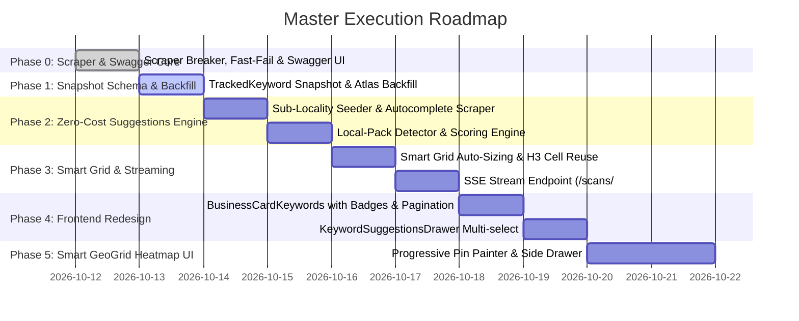

# Master Implementation Plan v3.0: Localo-Style Keyword Tracking, Multi-Locality Suggestions, Smart GeoGrid & Native Scraper Engine

> **Scope & Guarantee**: 
> - **100% Zero Paid APIs**: Strictly **NO** DataForSEO, **NO** external SERP APIs, **NO** third-party AI APIs. 
> - **Native Scraper Architecture**: Powered solely by our built-in `GOOGLE_MAPS_HTTP` scraper, native proxy manager, public Google Autocomplete suggest engine, and local SERP parsers.
> - **Complete OpenAPI 3.1 / Swagger Documentation**: Fully maintained and synchronized across all endpoints at `/docs`.
> - **Production-Grade Localo UX**: Smart Grid auto-sizing (9–49 points), progressive SSE pin streaming, sub-locality neighborhood suggestions (e.g. *Delhi* → *Moti Nagar*, *Punjabi Bagh*), and unlimited keyword tracking with lean pagination (`limit=50`).

---

## 1. Unified Architecture: End-to-End System Diagram

```
┌────────────────────────────────────────────────────────────────────────────────────────┐
│ 1. NATIVE SCRAPER & PROXY ENGINE (Backend Core - Zero Paid APIs)                       │
│    • In-house GOOGLE_MAPS_HTTP Provider + Proxy Manager + Circuit Breaker              │
│    • Business Place Search & Detail Resolver (native protobuf/HTTP parser)             │
│    • Fast-fail circuit breaker: Trips immediately on 403 / 429 / CAPTCHA (no retries)  │
└───────────────────────────────────────────┬────────────────────────────────────────────┘
                                            │ powers
┌───────────────────────────────────────────▼────────────────────────────────────────────┐
│ 2. KEYWORD INTELLIGENCE & SUGGESTIONS ENGINE (Rule-Based + Autocomplete)               │
│    • Category × City & Sub-Locality Seed Generator (bilingual: English & Devanagari)   │
│    • Public Google Autocomplete Scraper (suggestqueries.google.com, <300ms, free)       │
│    • Native SERP Local-Pack Detector (checks for Google Maps 3-Pack in HTML)           │
│    • Volume Tier Heuristics (Top 3 = Popular | 4-7 = Medium | 8+ = Niche)             │
│    • Unlimited tracking (quota-ready plumbing, paginated at 50/page)                   │
└───────────────────────────────────────────┬────────────────────────────────────────────┘
                                            │ triggers
┌───────────────────────────────────────────▼────────────────────────────────────────────┐
│ 3. SMART GEOGRID SCAN ENGINE                                                           │
│    • Auto-sizes 9 to 49 points (3x3 to 7x7) based on Area Difficulty Index             │
│    • H3 Cell Reuse: Caches inner cells (< 7 days) to save ~22% proxy requests          │
│    • Progressive SSE Streaming: Redis Pub/Sub → GET /v1/scans/:id/stream (8-pin batch) │
└───────────────────────────────────────────┬────────────────────────────────────────────┘
                                            │ onScanCompleted / onScanFailed
┌───────────────────────────────────────────▼────────────────────────────────────────────┐
│ 4. KEYWORD SNAPSHOT READ MODEL (TrackedKeyword in MongoDB Atlas)                       │
│    • Headline Rank: Center pin (the business's doorstep)                               │
│    • Unranked Pin/Keyword: Explicit `null` (never 0 or penalty 21; rendered as `20+`)   │
│    • Visibility Score: Share of Local Voice (SoLV = % of pins in top 3)                │
│    • Lean index projection: Response time < 300ms p95 for 100+ keywords                │
└───────────────────────────────────────────┬────────────────────────────────────────────┘
                                            │ visualizes
┌───────────────────────────────────────────▼────────────────────────────────────────────┐
│ 5. PREMIUM FRONTEND UI & SWAGGER API DOCS                                              │
│    • BusinessCardKeywords: Rank pill, trend sparkline, visibility bar, volume pill     │
│    • Suggestions Drawer: Multi-select neighborhood chips, Local Pack badges            │
│    • Smart GeoGrid Heatmap: Progressive live pin painter, difficulty outlines, drawer │
│    • Swagger UI: Interactive OpenAPI 3.1 documentation at /docs                        │
└────────────────────────────────────────────────────────────────────────────────────────┘
```

---

## 2. In-Depth Component Specifications

### 2.1 Native Scraper & Proxy Engine (No Third-Party APIs)

#### Core Rules & Provider Policy:
- **NFR-C1**: Mock provider strictly forbidden in production. `SERP_PROVIDER=MOCK` throws a fatal process error if `NODE_ENV === 'production'`.
- **NFR-C2**: Zero endless retry loops on blocks. If a proxy receives HTTP 403, 429, or a Google CAPTCHA, the circuit breaker immediately trips to `OPEN`, blacklists that proxy IP for 30 minutes, and fails the job cleanly without burning remaining quota.
- **NFR-C3**: Parser differentiates between `PARSED_ZERO_RESULTS` (valid query with 0 matching places) and `UNRECOGNISED_PAGE` (Google layout change or consent wall). Only `PARSED_ZERO_RESULTS` can write to the cache.
- **NFR-C4**: Caching pins stores `placeId`, `cid`, `lat`, `lng`, `name`, `address`, `phone`, `website`, and `rank` so cached pins match the target identically to live pins.
- **NFR-C5**: Business Places Search operates through our native Google Maps HTTP search parser (`src/providers/serp/google-maps-http.provider.ts`), resolving place cards, coordinates, and categories without Google Places API billing.

---

### 2.2 Advanced Zero-Cost Suggestions Engine with Sub-Localities

Real local customers search for businesses using neighborhood names and nearby landmarks rather than just the macro city.

#### Multi-Level Locality Seed Matrix:
- **Category Sources**: `Location.primaryCategory` (e.g. *Dentist* / *डेंटिस्ट*, *Farmstay* / *फार्मस्टे*) + `additionalCategories`.
- **Locality Sources**:
  - Macro City: `Location.city` (e.g. *Delhi*, *Rajpura*).
  - Micro Sub-Localities & Neighborhoods extracted from `Location.address`:
    - *Delhi* → *Moti Nagar*, *Punjabi Bagh*, *Kirti Nagar*, *Rajouri Garden*, *Ramesh Nagar*.
    - *Rajpura* → *Neelam Hospital Area*, *Gagan Chowk*, *Focal Point*, *Patiala Road*.
    - *Mumbai* → *Andheri West*, *Bandra*, *Juhu*, *Lokhandwala*.

#### Bilingual Permutation Generator:
```typescript
// Rule-based seed combinations without AI
const patterns = [
  // Micro Neighborhood (Highest Intent)
  `${category} ${sublocality}`,                       // "dentist moti nagar"
  `${sublocality} में ${category}`,                    // "मोती नगर में डेंटिस्ट"
  `${category} in ${sublocality}`,                    // "dentist in punjabi bagh"
  `${category} near ${sublocality}`,                  // "dentist near punjabi bagh"
  
  // Combined Macro + Micro
  `${category} ${sublocality} ${city}`,               // "dentist punjabi bagh delhi"
  `${city} ${sublocality} ${category}`,               // "दिल्ली मोती नगर डेंटिस्ट"
  
  // Transactional / Commercial Intent
  `${category} in ${sublocality} fees`,               // "dentist in moti nagar fees"
  `${sublocality} में बेस्ट ${category}`,              // "पंजाबी बाग में बेस्ट डेंटिस्ट"
  
  // Macro City (Fallback)
  `${category} ${city}`,                              // "dentist delhi"
  `${city} में ${category}`                           // "दिल्ली में डेंटिस्ट"
];
```

#### Native Google Autocomplete Scraper:
Calls Google's public endpoint `GET https://suggestqueries.google.com/complete/search?client=firefox&q={term}&hl={hl}&gl=IN`:
- **Free, public, requires no proxies, never CAPTCHAs, and responds in < 300ms**.
- Runs A–Z expansion (`{seed} a` ... `{seed} z`) and transactional modifiers (`{seed} near me`, `{seed} booking`, `{seed} best`).
- Preserves autocomplete rank position (1st suggestion = highest search frequency).

#### SERP Local-Pack Detector (`triggersLocalPack`):
- Checks HTML from our existing scraper parser for Google 3-Pack containers (`VkpGBb`, `class="rllt__link"`, `data-attrid="kc:/location/location:local_results"`).
- Queries triggering the Local Pack earn a **+40 points** boost, prioritizing keywords where Google shows a Map Pack over text-only results.

#### Search Volume Heuristics (Zero Paid APIs):
- Positions 1–3 in autocomplete: `POPULAR` (`🔥 Popular`)
- Positions 4–7 in autocomplete: `MEDIUM` (`⚡ Medium`)
- Position 8+ or expansion match: `LOW` (`🌱 Niche`)

#### Transparent Scoring Formula (0–100):
$$\text{Score} = \text{LocalPack}(0\text{–}40) + \text{AutocompleteRank}(0\text{–}40) + \text{LocalityIntentMatch}(0\text{–}20)$$
- **`dentist in punjabi bagh`**: LocalPack (40) + Auto Rank 1 (40) + Category & Sublocality Match (20) = **100/100 (Top Recommendation)**.
- **`dentist moti nagar`**: LocalPack (40) + Auto Rank 2 (40) + Category & Sublocality Match (20) = **100/100 (Top Recommendation)**.
- **`dentist delhi`**: LocalPack (40) + Auto Rank 4 (30) + Category & City Match (15) = **85/100 (High Competition)**.

---

### 2.3 Smart GeoGrid Heatmap & Progressive Pin Streaming

#### 1. Smart Grid Auto-Sizing Algorithm (9–49 Points):
Instead of forcing users to guess technical pin configurations, the algorithm automatically tailors the grid to the competitive density:
- **High Density / Metro** (Area Difficulty > 65): 37–49 points (300m–600m step radius).
- **Medium Density / Suburban** (Area Difficulty 35–65): 19–25 points (800m–1.5km step radius).
- **Low Density / Rural** (Area Difficulty < 35): 9–13 points (2km–5km step radius).
- **User-Facing Modes**:
  - `Quick Check`: 7–9 pins (Center + immediate ring, completes in ~30s on keyword add).
  - `Smart Grid`: Full auto-sized grid (19–49 pins) for comprehensive audits.

#### 2. H3 Cell Reuse Optimization:
When upgrading from Quick Check to Smart Grid, the engine reuses cached inner pins (< 7 days fresh) and queries **only the outer perimeter delta pins**, slashing proxy requests and execution time by ~22%.

#### 3. Progressive SSE Streaming (`GET /v1/scans/:id/stream`):
- Scraper processes pins in concurrent batches of 8.
- Publishes batch completions to Redis Pub/Sub channel `scan:progress:{scanId}`.
- SSE stream broadcasts batches live to the browser.
- Frontend paints pins onto the map as they arrive—no waiting for all 49 pins to finish.

#### 4. Industry-Standard Heatmap Visualization:
- **Pins**:
  - Green (1–3): Top results ("Dominating").
  - Yellow/Amber (4–10): Page-one visibility.
  - Red (11–20): Low ranking.
  - Slate Grey (`20+`): Not in top 20 at all (stored as `rank: null`, never 0 or 21).
- **Outlines**: Colored by local pin difficulty (Green = easy to improve, Orange = medium, Red = fierce competition).
- **Headline Rank Contract**: The rank at the **Center Pin** (the business's verified address) is the headline rank across the table, dashboard, and map. ARP (Average Rank Position) is displayed as a secondary metric.

---

### 2.4 Quota-Ready / Unlimited Keyword Model

- **No Hard Limit**: Users can track 10, 30, 50, 100+ keywords with zero 403 quota errors.
- **Quota-Ready Plumbing**: `Location.keywordLimit?: number | null` (defaults to `null` = unlimited). Can be capped to 10 in the future with a 1-line configuration change.
- **Sub-300ms Performance via Lean Pagination**:
  - `GET /v1/locations/:id/keywords?limit=50&offset=0`.
  - Queries `TrackedKeyword` with selective projection (`.select(...)`), completely avoiding joins with heavy 49-pin scan documents.

---

## 3. OpenAPI 3.1 & Swagger Documentation Architecture

All API endpoints are documented with OpenAPI 3.1 using Zod route schemas, avoiding documentation drift. Swagger UI is served at `/docs`.

### Complete Endpoint Registry:

```
┌────────────────────────────────────────────────────────────────────────────────────────┐
│ SWAGGER / OPENAPI 3.1 ENDPOINT REGISTRY (/docs)                                        │
├───────────────────────────────┬────────────────────────────────────────────────────────┤
│ Method & Path                 │ Description & Purpose                                  │
├───────────────────────────────┼────────────────────────────────────────────────────────┤
│ GET  /v1/locations/:id/keywords   │ List snapshot rows (paginated limit=50, sub-300ms)  │
│ POST /v1/locations/:id/keywords   │ Add keyword (idempotent, triggers Quick Check scan)    │
│ DELETE /v1/keywords/:id           │ Remove tracked keyword and its snapshot               │
│ GET  /v1/locations/:id/keyword-suggestions │ Get top 30 neighborhood & city suggestions│
│ POST /v1/keywords/:id/scan        │ Manual scan trigger (Quick Check or Smart Grid)       │
│ GET  /v1/scans/:id                │ Get full scan with pins, ARP, and competitor data      │
│ GET  /v1/scans/:id/stream         │ Server-Sent Events (SSE) progressive pin stream        │
│ GET  /v1/keywords/:id/history     │ Get historical sparkline array (nulls preserved)       │
│ GET  /v1/places/search            │ Native Places search resolver (Google Maps scraper)    │
│ GET  /docs                        │ Swagger UI documentation interface                     │
│ GET  /docs/openapi.json           │ Raw OpenAPI 3.1 JSON specification                     │
└───────────────────────────────┴────────────────────────────────────────────────────────┘
```

#### OpenAPI Schema Specification (`Backend/core-service/src/docs/swagger.ts`):
- Uses `swagger-ui-express` and Zod-generated components.
- Documented error responses: `400 Bad Request`, `401 Unauthorized`, `404 Not Found`, `429 Rate Limited`.
- Security schema: `BearerAuth` (JWT) and `CookieAuth` (`access_token`).

---

## 4. Data Models & TypeScript Types

### 4.1 `ITrackedKeywordSnapshot` (`packages/types/src/keywords.ts`)
```typescript
export type KeywordRankState = 'RANKED' | 'NOT_IN_TOP_20' | 'UNKNOWN';
export type KeywordScanStatus = 'NOT_SCANNED' | 'QUEUED' | 'SCANNING' | 'SCANNED' | 'PARTIAL' | 'FAILED' | 'NO_LOCAL_RESULTS';
export type VolumeTier = 'POPULAR' | 'MEDIUM' | 'LOW';
export type GridType = 'QUICK' | 'SMART_GRID';

export interface ITrackedKeywordSnapshot {
  currentRank: number | null;            // Observed rank at center pin (null if > 20)
  previousRank: number | null;           // Rank from previous successful scan
  rankState: KeywordRankState;           // RANKED (1-20), NOT_IN_TOP_20, UNKNOWN
  
  // Free Keyword Intelligence
  volumeTier: VolumeTier;                // POPULAR, MEDIUM, LOW (autocomplete position)
  searchVolume: number | null;           // Exact volume when available (null for v1)
  triggersLocalPack: boolean;            // True if query renders Google Maps 3-Pack
  
  // Visibility Metrics
  visibilityScore: number;               // Business Visibility (0-100%, Share of Local Voice)
  visibilityDelta: number;               // Visibility change since prior scan
  sparkline: Array<{
    date: Date;
    rank: number | null;                 // Explicit null when unranked (never 0 or 21)
    visibility: number;
    scanId: string;
  }>;
  
  lastScannedAt: Date | null;
  lastSuccessfulScanAt: Date | null;
  scanStatus: KeywordScanStatus;
  lastScanError: string | null;
  gridType: GridType;
  lastScanId: string | null;
  source: 'MANUAL' | 'SUGGESTION' | 'RECOMMENDED_SEED';
}
```

### 4.2 `Location` Model Updates (`Backend/core-service/src/models/Location.ts`)
```typescript
interface ILocation {
  // Existing fields...
  coordinatesVerified: boolean;         // Verified coordinates required before scans run
  areaDifficultyIndex: number;          // 0-100 area difficulty rating
  businessVisibilityScore: number;      // Aggregated local visibility (0-100%)
  sublocalities: string[];              // Extracted sub-localities (e.g. ['Moti Nagar', 'Punjabi Bagh'])
  keywordLimit?: number | null;         // null = UNLIMITED today; quota-ready for future tiers
  onboardingGuidedAt: Date | null;      // Records guided onboarding timestamp
}
```

---

## 5. Frontend UI Specifications

### 5.1 `BusinessCardKeywords.tsx` (Table & Controls)
- **Header**:
  - `Tracked Keywords ({total})` + Search filter + "Add Keyword" button.
  - Guided onboarding banner when `total === 0`:
    *"Area Difficulty: Medium (64/100). Track high-impact phrases in your neighborhood that trigger Google's Local Pack."*
- **Table Columns**:
  1. `Keyword`: Keyword title + `📍 Local Pack` badge + Volume pill (`🔥 Popular` / `⚡ Medium` / `🌱 Niche`).
  2. `Trend`: Responsive SVG sparkline with green/red/grey trajectory (omitted if only 1 scan).
  3. `Center Rank`: Badge (`#1`, `#6`, `20+`) + movement delta (`↑ 2`, `↓ 1`).
  4. `Business Visibility`: Radar icon + progress bar + percentage (`68%`) + delta (`+5%`).
  5. `Updated`: Relative time ("Updated 2d ago") + manual refresh trigger.
- **Pagination**: Bottom controls (*"Showing 1–50 of {total}"*) with Previous/Next.
- **Row Click**: Navigates directly to the Smart GeoGrid Map page.

### 5.2 Suggestions Drawer (`KeywordSuggestionsDrawer.tsx`)
- Slide-over drawer listing up to 30 suggestions with category chips:
  - Filter chips: `All` | `Nearby Neighborhoods` | `City Wide` | `Local Pack Only`.
  - Multi-select checkboxes + "Add Selected ({N}) Keywords".
  - Adding triggers a 7-pin Quick Check scan for each keyword immediately.

### 5.3 Smart GeoGrid Heatmap (`GeoGridHeatmap.tsx`)
- Auto-sized grid (9–49 points) based on `areaDifficultyIndex`.
- Progressive SSE pin streaming (`GET /v1/scans/:id/stream`) painting pins live in 8-pin batches.
- Center pin highlighted as **Headline Rank** matching the table badge.
- Side drawer: Shows Area Difficulty, SoLV, ARP, competitor ranks, and individual pin result cards.

---

## 6. Execution Roadmap: 6 Clear Phases



---

## 7. Acceptance Verification Matrix

| # | Test Scenario | Expected Outcome |
|---|---|---|
| **1** | Native Places Search | Searches business by name/city using native scraper; resolves details without paid Google APIs. |
| **2** | Sub-Locality Suggestions | For Delhi clinic, returns neighborhood queries (`dentist moti nagar`, `dentist punjabi bagh`) with `triggersLocalPack: true` and `volumeTier: POPULAR`. |
| **3** | Add Keyword & Quick Scan | Keyword saved as `QUEUED`, Quick Check (7 pins) starts via native scraper, row fills within 60s. |
| **4** | Unlimited Keyword Tracking | Adding 15, 30, 50+ keywords succeeds with zero quota warnings; table paginates cleanly at 50/page and loads in <300ms p95. |
| **5** | Unranked Pin/Keyword | Center rank shows `20+`, sparkline stores explicit `null` (never 0 or 21). |
| **6** | Progressive Pin Streaming | During scan, map updates progressively as 8-pin batches complete via SSE `/v1/scans/:id/stream`. |
| **7** | Scraper Block Resilience | Proxy block immediately trips breaker and marks scan FAILED; row keeps previous rank. |
| **8** | Production Mock Block | `NODE_ENV=production` with `SERP_PROVIDER=MOCK` terminates with a clear configuration error. |
| **9** | Swagger UI Availability | Navigating to `/docs` renders interactive OpenAPI 3.1 UI documenting all registered routes. |

---

*Ready for execution upon your confirmation.*
